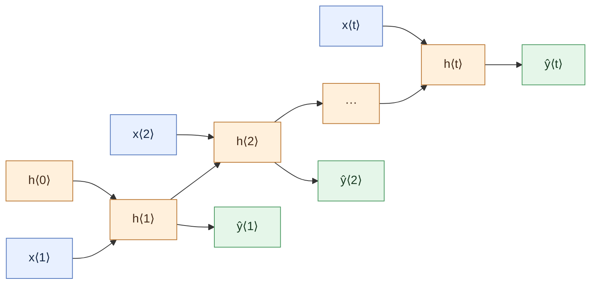
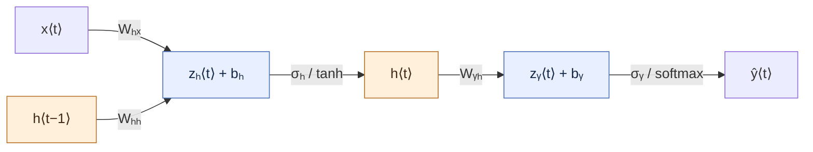

# Building a Recurrent Neural Network (RNN) from scratch — phần lý thuyết

The theory and formulas below cover sections 1–2.3. The manual Seq2Seq RNN implementation and its educational notebooks are now available in `src/` and `experiments/`.

**Practical project:** build a vanilla RNN for English-Vietnamese translation using the local `src/`, `data/`, and `experiments/` directories. See the [translation plan](TRANSLATION_PLAN.md) for the project layout and notebook order. The theory and formulas below retain their existing structure.

## Mục lục

1. [Recurrent Neural Network Overview](#1-recurrent-neural-network-overview)
2. [Describing the RNN mathematically](#2-describing-the-rnn-mathematically)
   - [2.1 Forward Propagation](#21-forward-propagation)
   - [2.2 Backward Propagation](#22-backward-propagation)
   - [2.2.1 Deriving Components In Backpropagation Through Time](#221-deriving-components-in-backpropagation-through-time)
   - [2.3 The Vanishing & Exploding Gradient Problem](#23-the-vanishing--exploding-gradient-problem)

## 1. Recurrent Neural Network Overview

RNN xử lý dữ liệu tuần tự bằng cách giữ lại một trạng thái ẩn giữa các bước thời gian. Ở bước $t$, trạng thái $h^{\langle t\rangle}$ nhận thông tin từ đầu vào mới $x^{\langle t\rangle}$ và trạng thái trước $h^{\langle t-1\rangle}$. Khi “trải” RNN ra theo thời gian, ta thấy cùng một phép tính được lặp lại ở mọi vị trí của chuỗi.

Mỗi $h^{\langle t\rangle}$ có hai đầu vào: $x^{\langle t\rangle}$ và $h^{\langle t-1\rangle}$. Tất cả các bước dùng chung các ma trận trọng số, nhờ đó mô hình có thể áp dụng cùng một quy tắc chuyển trạng thái ở các vị trí khác nhau. Nếu xếp nhiều lớp RNN, tại mỗi bước còn có luồng thông tin giữa các lớp; phần toán học bên dưới chỉ xét một lớp để dễ theo dõi.

Trong [Seq2Seq Stage 1 của dự án dịch máy](../../MachineTraslation/README.md), encoder chuyển trạng thái cuối sang decoder. Đây là **nút thắt trạng thái cuối**: một trạng thái kích thước cố định phải tóm tắt cả câu nguồn, nên thông tin ở đầu câu dài có thể bị mất. Stage 1 chưa dùng attention. Trong lúc huấn luyện decoder, **Teacher Forcing** dùng token đích thật của bước trước làm đầu vào tiếp theo, giúp tối ưu trên ngữ cảnh đích đúng; khi suy luận, decoder dùng token do chính nó dự đoán.

## 2. Describing the RNN mathematically

### Ký hiệu trước khi đọc công thức

Bài tham khảo dùng **vector cột** và viết ma trận ở **bên trái** vector. Chỉ số trên $\langle t\rangle$ là **bước thời gian**, không phải lũy thừa. Trong các công thức dưới đây, $D$ là chiều đầu vào, $H$ là chiều ẩn và $V$ là số lớp đầu ra (chẳng hạn số token trong từ vựng).

| Ký hiệu | Ý nghĩa | Kích thước theo vector cột |
|---|---|---|
| $x^{\langle t\rangle}$ | Đầu vào tại bước $t$; $x^{\langle 1\rangle}$ là đầu vào bước đầu tiên | $[D,1]$ |
| $h^{\langle t-1\rangle}$, $h^{\langle t\rangle}$ | Trạng thái ẩn trước và sau bước $t$ | $[H,1]$ |
| $h^{\langle 0\rangle}$ | Trạng thái ẩn ban đầu | $[H,1]$ |
| $z_h^{\langle t\rangle}$ | Giá trị trước kích hoạt của nút ẩn | $[H,1]$ |
| $z_y^{\langle t\rangle}$ | Logit trước kích hoạt đầu ra | $[V,1]$ |
| $\hat y^{\langle t\rangle}$, $y^{\langle t\rangle}$ | Dự đoán xác suất và nhãn đúng dạng one-hot | $[V,1]$ |
| $W_{hx}$ | Truyền từ $x$ sang $h$ | $[H,D]$ |
| $W_{hh}$ | Truyền từ $h$ trước sang $h$ hiện tại | $[H,H]$ |
| $W_{yh}$ | Truyền từ $h$ sang đầu ra $y$ | $[V,H]$ |
| $b_h$, $b_y$ | Bias của nút ẩn và đầu ra | $[H,1]$, $[V,1]$ |

> **Khi chuyển sang PyTorch của dự án:** phần LSTM dùng $x_t$, $h_t$, $c_t$ và quy ước vector hàng. Vì vậy $x^{\langle t\rangle}$ ở trang này tương ứng với $x_t$ sau này, còn $W_{hx}$ và $W_{yh}$ ở đây sẽ được chuyển vị thành các ma trận nhân bên phải vector hàng. Không đem trực tiếp chiều ma trận của bảng này vào code PyTorch. RNN cơ bản trong bài này chưa có cell state $c_t$.

### 2.1 Forward Propagation

**Net Input to Node h:**

$$
\boxed{z_h^{\langle t\rangle}=W_{hx}x^{\langle t\rangle}+W_{hh}h^{\langle t-1\rangle}+b_h}
$$

**Activation at Node h:**

$$
\boxed{h^{\langle t\rangle}=\sigma_h\!\left(z_h^{\langle t\rangle}\right)}
$$

Trong ví dụ này, $\sigma_h=\tanh$. Trạng thái nhận được vừa đi tới bước kế tiếp, vừa được dùng để tính đầu ra hiện tại.

**Net Input to Node y:**

$$
\boxed{z_y^{\langle t\rangle}=W_{yh}h^{\langle t\rangle}+b_y}
$$

**Output at Node y:**

$$
\boxed{\hat y^{\langle t\rangle}=\sigma_y\!\left(z_y^{\langle t\rangle}\right)}
$$

Với bài toán phân loại token, $\sigma_y=\operatorname{softmax}$. Bộ trọng số $W_{hx}$, $W_{hh}$, $W_{yh}$ được chia sẻ giữa các bước $t$.

### 2.2 Backward Propagation

Chọn cross-entropy làm hàm mất mát. Vì mạng có đầu ra ở từng bước thời gian, loss toàn chuỗi là tổng các loss thành phần, đúng như hình số 7:

$$
\boxed{L=\sum_{t=1}^{T}L^{\langle t\rangle}}
$$

BPTT (*Backpropagation Through Time*) tính đạo hàm từ bước cuối về bước đầu trên RNN đã được trải theo thời gian.

### 2.2.1 Deriving Components In Backpropagation Through Time

Bắt đầu với cross-entropy tại một bước (bài gốc viết ở dạng vô hướng):

$$
L^{\langle t\rangle}=-y^{\langle t\rangle}\log\!\left(\hat y^{\langle t\rangle}\right)
$$

Đạo hàm theo giá trị dự đoán:

$$
\boxed{
\frac{\partial L^{\langle t\rangle}}
     {\partial\hat y^{\langle t\rangle}}
=-\frac{y^{\langle t\rangle}}{\hat y^{\langle t\rangle}}
}
$$

Kết hợp đạo hàm của softmax với loss:

$$
\boxed{
\begin{aligned}
\frac{\partial L^{\langle t\rangle}}
     {\partial z_y^{\langle t\rangle}}
&=
\frac{\partial L^{\langle t\rangle}}
     {\partial\hat y^{\langle t\rangle}}
\cdot
\frac{\partial\hat y^{\langle t\rangle}}
     {\partial z_y^{\langle t\rangle}}\\
&=
-\frac{y^{\langle t\rangle}}{\hat y^{\langle t\rangle}}
\cdot
\frac{\partial\,\operatorname{softmax}}
     {\partial z_y^{\langle t\rangle}}
=
\hat y^{\langle t\rangle}-y^{\langle t\rangle}.
\end{aligned}
}
$$

Tiếp theo là ma trận $W_{yh}$:

$$
\boxed{
\begin{aligned}
\frac{\partial L^{\langle t\rangle}}{\partial W_{yh}}
&=
\frac{\partial L^{\langle t\rangle}}
     {\partial z_y^{\langle t\rangle}}
\cdot
\frac{\partial z_y^{\langle t\rangle}}{\partial W_{yh}}\\
&=
\frac{\partial L^{\langle t\rangle}}
     {\partial z_y^{\langle t\rangle}}
\cdot
\frac{\partial\!\left(W_{yh}h^{\langle t\rangle}+b_y\right)}
     {\partial W_{yh}}\\
&=
\left(\hat y^{\langle t\rangle}-y^{\langle t\rangle}\right)
\cdot h^{\langle t\rangle}.
\end{aligned}
}
$$

Và bias $b_y$:

$$
\boxed{
\begin{aligned}
\frac{\partial L^{\langle t\rangle}}{\partial b_y}
&=
\frac{\partial L^{\langle t\rangle}}
     {\partial z_y^{\langle t\rangle}}
\cdot
\frac{\partial z_y^{\langle t\rangle}}{\partial b_y}\\
&=
\frac{\partial L^{\langle t\rangle}}
     {\partial z_y^{\langle t\rangle}}
\cdot
\frac{\partial\!\left(W_{yh}h^{\langle t\rangle}+b_y\right)}
     {\partial b_y}\\
&=
\hat y^{\langle t\rangle}-y^{\langle t\rangle}.
\end{aligned}
}
$$

$h^{\langle t\rangle}$ đóng góp vào dự đoán hiện tại, đồng thời đi vào bước $t+1$. Bài gốc xét hai nhánh gradient theo thứ tự đó. Nhánh từ đầu ra hiện tại:

$$
\boxed{
\begin{aligned}
\frac{\partial L^{\langle t\rangle}}
     {\partial h^{\langle t\rangle}}
&=
\frac{\partial L^{\langle t\rangle}}
     {\partial z_y^{\langle t\rangle}}
\cdot
\frac{\partial z_y^{\langle t\rangle}}
     {\partial h^{\langle t\rangle}}\\
&=
\frac{\partial L^{\langle t\rangle}}
     {\partial z_y^{\langle t\rangle}}
\cdot
\frac{\partial\!\left(W_{yh}h^{\langle t\rangle}+b_y\right)}
     {\partial h^{\langle t\rangle}}\\
&=
\left(\hat y^{\langle t\rangle}-y^{\langle t\rangle}\right)
\cdot W_{yh}.
\end{aligned}
}
$$

Nhánh qua trạng thái kế tiếp:

$$
\boxed{
\begin{aligned}
\frac{\partial L^{\langle t+1\rangle}}
     {\partial h^{\langle t\rangle}}
&=
\frac{\partial L^{\langle t+1\rangle}}
     {\partial z^{\langle t+1\rangle}}
\cdot
\frac{\partial z^{\langle t+1\rangle}}
     {\partial h^{\langle t\rangle}}\\
&=
\frac{\partial L^{\langle t+1\rangle}}
     {\partial z^{\langle t+1\rangle}}
\cdot
\frac{\partial\!\left(
 W_{hx}x^{\langle t+1\rangle}
 +W_{hh}h^{\langle t\rangle}+b_h\right)}
     {\partial h^{\langle t\rangle}}\\
&=
\frac{\partial L^{\langle t+1\rangle}}
     {\partial z^{\langle t+1\rangle}}
\cdot W_{hh}.
\end{aligned}
}
$$

Cộng hai nhánh — kể cả nhãn đạo hàm ở vế trái như trong hình số 9:

$$
\boxed{
\frac{\partial L^{\langle t+1\rangle}}
     {\partial h^{\langle t\rangle}}
=
\left(
 \left(\hat y^{\langle t\rangle}-y^{\langle t\rangle}\right)
 \cdot W_{yh}
\right)
+
\left(
 \frac{\partial L^{\langle t+1\rangle}}
      {\partial z^{\langle t+1\rangle}}
 \cdot W_{hh}
\right)
}
$$

Đạo hàm đi tiếp qua $\tanh$ để đến $z_h^{\langle t\rangle}$:

$$
\boxed{
\begin{aligned}
\frac{\partial L^{\langle t\rangle}}
     {\partial z_h^{\langle t\rangle}}
&=
\frac{\partial L^{\langle t\rangle}}
     {\partial h^{\langle t\rangle}}
\cdot
\frac{\partial h^{\langle t\rangle}}
     {\partial z_h^{\langle t\rangle}}\\
&=
\frac{\partial L^{\langle t\rangle}}
     {\partial h^{\langle t\rangle}}
\cdot
\frac{\partial\tanh\!\left(z_h^{\langle t\rangle}\right)}
     {\partial z_h^{\langle t\rangle}}\\
&=
\left(1-\tanh\!\left(z_h^{\langle t\rangle}\right)^2\right)
\cdot
\frac{\partial L^{\langle t\rangle}}
     {\partial h^{\langle t\rangle}}.
\end{aligned}
}
$$

Từ $z_h^{\langle t\rangle}=W_{hx}x^{\langle t\rangle}+W_{hh}h^{\langle t-1\rangle}+b_h$, ta lần lượt có:

$$
\boxed{
\begin{aligned}
\frac{\partial L^{\langle t\rangle}}{\partial W_{hx}}
&=
\frac{\partial L^{\langle t\rangle}}
     {\partial z_h^{\langle t\rangle}}
\cdot
\frac{\partial z_h^{\langle t\rangle}}{\partial W_{hx}}\\
&=
\frac{\partial L^{\langle t\rangle}}
     {\partial z_h^{\langle t\rangle}}
\cdot
\frac{\partial\!\left(
 W_{hx}x^{\langle t\rangle}
 +W_{hh}h^{\langle t-1\rangle}+b_h\right)}
     {\partial W_{hx}}\\
&=
\frac{\partial L^{\langle t\rangle}}
     {\partial z_h^{\langle t\rangle}}
\cdot x^{\langle t\rangle}.
\end{aligned}
}
$$

$$
\boxed{
\begin{aligned}
\frac{\partial L^{\langle t\rangle}}{\partial W_{hh}}
&=
\frac{\partial L^{\langle t\rangle}}
     {\partial z_h^{\langle t\rangle}}
\cdot
\frac{\partial z_h^{\langle t\rangle}}{\partial W_{hh}}\\
&=
\frac{\partial L^{\langle t\rangle}}
     {\partial z_h^{\langle t\rangle}}
\cdot
\frac{\partial\!\left(
 W_{hx}x^{\langle t\rangle}
 +W_{hh}h^{\langle t-1\rangle}+b_h\right)}
     {\partial W_{hh}}\\
&=
\frac{\partial L^{\langle t\rangle}}
     {\partial z_h^{\langle t\rangle}}
\cdot h^{\langle t-1\rangle}.
\end{aligned}
}
$$

$$
\boxed{
\begin{aligned}
\frac{\partial L^{\langle t\rangle}}{\partial b_h}
&=
\frac{\partial L^{\langle t\rangle}}
     {\partial z_h^{\langle t\rangle}}
\cdot
\frac{\partial z_h^{\langle t\rangle}}{\partial b_h}\\
&=
\frac{\partial L^{\langle t\rangle}}
     {\partial z_h^{\langle t\rangle}}
\cdot
\frac{\partial\!\left(
 W_{hx}x^{\langle t\rangle}
 +W_{hh}h^{\langle t-1\rangle}+b_h\right)}
     {\partial b_h}\\
&=
\frac{\partial L^{\langle t\rangle}}
     {\partial z_h^{\langle t\rangle}}.
\end{aligned}
}
$$

Gradient cần truyền tiếp về bước $t-1$:

$$
\frac{\partial L^{\langle t\rangle}}
     {\partial h^{\langle t-1\rangle}}
=
\frac{\partial L^{\langle t\rangle}}
     {\partial z^{\langle t\rangle}}
\cdot W_{hh}.
$$

Cuối mục 2.2.1, bài gốc viết các phép cập nhật dựa trên gradient của bước $t$:

$$
\begin{aligned}
W_{yh}&=W_{yh}-\alpha\cdot
\frac{\partial L^{\langle t\rangle}}{\partial W_{yh}},\\
b_y&=b_y-\alpha\cdot
\frac{\partial L^{\langle t\rangle}}{\partial b_y},\\
W_{hx}&=W_{hx}-\alpha\cdot
\frac{\partial L^{\langle t\rangle}}{\partial W_{hx}},\\
W_{hh}&=W_{hh}-\alpha\cdot
\frac{\partial L^{\langle t\rangle}}{\partial W_{hh}},\\
b_h&=b_h-\alpha\cdot
\frac{\partial L^{\langle t\rangle}}{\partial b_h}.
\end{aligned}
$$

### 2.3 The Vanishing & Exploding Gradient Problem

Mở đầu mục này, bài viết nhắc lại đạo hàm theo $W_{hh}$:

$$
\boxed{
\begin{aligned}
\frac{\partial L^{\langle t\rangle}}{\partial W_{hh}}
&=
\frac{\partial L^{\langle t\rangle}}
     {\partial z_h^{\langle t\rangle}}
\cdot
\frac{\partial z_h^{\langle t\rangle}}{\partial W_{hh}}\\
&=
\frac{\partial L^{\langle t\rangle}}
     {\partial z_h^{\langle t\rangle}}
\cdot
\frac{\partial\!\left(
 W_{hx}x^{\langle t\rangle}
 +W_{hh}h^{\langle t-1\rangle}+b_h\right)}
     {\partial W_{hh}}\\
&=
\frac{\partial L^{\langle t\rangle}}
     {\partial z_h^{\langle t\rangle}}
\cdot h^{\langle t-1\rangle}.
\end{aligned}
}
$$

$h^{\langle t-1\rangle}$ lại phụ thuộc vào các bước sớm hơn. Quy tắc cập nhật trạng thái ẩn là:

$$
h^{\langle t\rangle}
=\tanh\!\left(
W_{hx}x^{\langle t\rangle}
+W_{hh}h^{\langle t-1\rangle}+b_h
\right).
$$

Do đó ảnh hưởng của $W_{hh}$ lên trạng thái ở bước $t$ có cả đường trực tiếp lẫn đường đi qua từng trạng thái trước đó. Công thức tổng trong hình số 13:

$$
\boxed{
\frac{\partial L^{\langle t\rangle}}{\partial W_{hh}}
=
\frac{\partial L^{\langle t\rangle}}{\partial y^{\langle t\rangle}}
\cdot
\frac{\partial y^{\langle t\rangle}}{\partial h^{\langle t\rangle}}
\cdot
\left(
\sum_{k=1}^{t}
\frac{\partial h^{\langle t\rangle}}{\partial h^{\langle k\rangle}}
\cdot
\frac{\partial h^{\langle k\rangle}}{\partial W_{hh}}
\right)
}
$$

Đạo hàm giữa hai trạng thái cách nhau nhiều bước là tích các đạo hàm của những bước liền kề (hình số 14):

$$
\boxed{
\frac{\partial h^{\langle t\rangle}}{\partial h^{\langle k\rangle}}
=
\prod_{i=k+1}^{t}
\frac{\partial h^{\langle i\rangle}}
     {\partial h^{\langle i-1\rangle}}
}
$$

Nếu tích này liên tục co lại, gradient về những bước đầu **biến mất**, khiến RNN khó học quan hệ xa. Nếu nó liên tục tăng, gradient **bùng nổ** và cập nhật tham số có thể mất ổn định.

> **Lưu ý khi hiện thực về sau:** các biểu thức trên giữ nguyên cách viết tắt trong ảnh. Dấu $\cdot$ ở đạo hàm theo ma trận cần được diễn giải thành phép nhân Jacobian hoặc tích ngoài đúng chiều. Một số nhãn $L^{\langle t+1\rangle}$ và $y^{\langle t\rangle}$ trong ảnh chưa nhất quán với loss toàn chuỗi và $\hat y^{\langle t\rangle}$; sẽ làm rõ trước khi chuyển thành code, thay vì tự sửa các công thức đang được đối chiếu.

---

Công thức được trình bày theo đúng thứ tự của 14 ảnh người dùng cung cấp đến hết mục 2.3.
